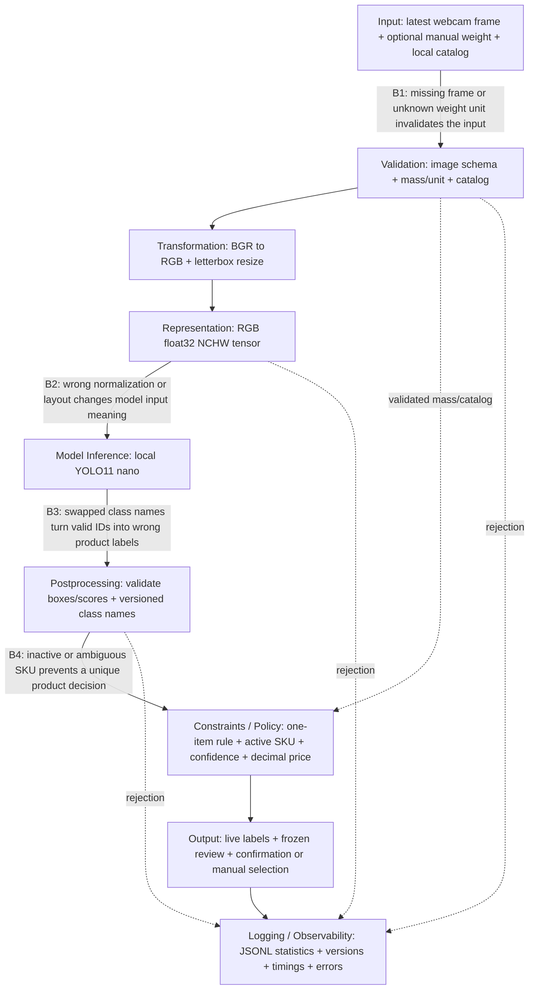

# Project Assignment 2: Produce Recognition Pipeline

Ryan Schader | ECE 6/5540 | October 13, 2026

A Windows prototype uses a USB webcam and a local lightweight detector to suggest produce categories, map them to active catalog entries, and calculate an estimated price from manually entered weight. The interface updates predictions continuously and requires a frozen-frame review and explicit customer confirmation. The assignment source in this workspace is `project_part2_req.txt`.

## 1. Updated architecture diagram

Image inference is separate from catalog policy and pricing. A learned fusion classifier is deferred because paired image/weight/catalog training data is not available. Total weight measures quantity; it is not treated as evidence of category identity. A visual category does not determine variety or organic status.

A camera thread publishes into a single-slot buffer. Reconnects serialize camera ownership in the background, and the fixed-geometry video viewport prevents live updates from moving controls during clicks. An inference worker processes the latest available frame and passes a versioned result to the Qt interface. The displayed boxes and labels belong to the displayed analyzed image. Superseded settings/session results are discarded. Freezing atomically retains that image for review; confirmation revalidates the current mass and catalog. Manual weight editing recalculates the interface estimate independently of the recognition worker; the live worker uses preview mode and the confirmed mass is saved with the confirmation record.

## 2. Explicit boundary contracts

| Boundary / version | Input shape and type -> output shape and type | Units / allowed ranges | Missing-data policy |
| --- | --- | --- | --- |
| Input -> Validation, `scan-v1` plus preview mode | HWC BGR uint8 array, mass string or absent value, unit string, catalog object -> validated image, Decimal kg or null in preview, validated catalog | C=3; H 32-2160; W 32-3840; pixels 0-255; kg/g/lb; mass (0,20] kg | Missing/undecodable frames, invalid mass, and unknown units are rejected. Absent mass is allowed only for recognition preview; it never enables confirmation or produces a price. |
| Representation -> Inference, `rgb-nchw-01-v1` | Letterboxed RGB uint8[S,S,3] -> contiguous float32[1,3,S,S] | S=320/416/640; finite dimensionless values [0,1] | Wrong shape, dtype, range, or version rejects the frame before inference; no second normalization is silently applied. |
| Inference -> Postprocessing, label-map SHA-256 | Float[N,6] rows x1,y1,x2,y2,score,class_id plus model names -> label/score/box dictionaries | N 0-300; 0<=x1<x2<=S, 0<=y1<y2<=S in padded model pixels; score [0,1]; integral mapped IDs | Empty output is valid and abstains. Missing/invalid rows or a label-map mismatch reject the result. |
| Catalog/Policy -> Output, `catalog-v1` / `checkout-v1` | Detections + Decimal kg or preview null + catalog -> status, candidate list, nullable price strings, confirmation bool | USD/kg prices (0,1000]; 1-100 items; unique SKU strings 1-40 characters; boolean active; automatic score threshold 0.60 | No active/unique match, multiple detections, or low confidence requires explicit manual selection. Missing weight suppresses price. Confirmation defaults false. |

RGB/BGR semantic errors and plausible numbers mislabeled with the wrong mass unit can pass numeric bounds. A known-red-image transform test checks the real BGR-to-RGB conversion and letterbox geometry. A future scale adapter must supply trustworthy source/unit metadata and synchronized timestamps. Pricing uses Decimal and rounds half-up to cents. Output boxes are inverse-mapped through saved padding/scales for the interface.

## 3. Minimal working implementation and verification

`prototype.py` and `pipeline_core.py` implement input validation, transformation, tensor representation, a real model call, postprocessing, catalog policy, price calculation, and intermediate logging. `live_engine.py` adds bounded capture/inference workers; `live_app.py` provides the interface. The default model is the installed official YOLO11 nano COCO checkpoint. It covers apple, banana, orange, carrot, and broccoli; other demo catalog entries are available through manual selection. The broader Open Images checkpoint remains optional after it gave less useful specific labels on the supplied examples.

Run `.venv/Scripts/python.exe verify_requirements.py --camera 0 --ui` to reproduce the verification. Recorded results in [verification.json](evidence/verification.json):

- 30 contract/policy/worker/UI tests passed, including actual OpenCV color/geometry checks, invalid data, active/ambiguous catalog handling, bounded buffering, confirmation rechecks, and one-shot failure recovery.
- Actual inference on an attributed cropped public apple image produced an apple score of 0.8365 and a $1.50 estimate for 500 g at $3/kg, with confirmation initially false.
- Earlier [camera verification](evidence/camera_verification.json) supplied five 640x480 frames from camera 0 that underwent actual inference; mean service time was 29.4 ms. Camera images were not saved.
- Qt integration used actual inference and verified recognition, weight entry, freeze-before-confirm, a logged confirmation, and disabled confirmation for invalid mass. A [rendered preview](evidence/interface.png) was visually inspected; this integration check used an offscreen display, not a desktop screenshot.

These checks establish pipeline behavior, not produce accuracy across a dataset. Source checkpoint hashes and label-map hashes are saved with evidence. Sample provenance is in [SOURCES.md](../samples/SOURCES.md). A confirmation is a local demo record; payment processing is outside scope.

## 4. Failure injection and analysis

Both faults were executed using the real pipeline and a public image. [actual_pipeline.jsonl](evidence/actual_pipeline.jsonl) records the intermediate statistics and rejections. A subsequent normal pass succeeded.

| Fault / what changed | Did it crash or silently fail? | Boundary allowed/caught it | Architectural prevention |
| --- | --- | --- | --- |
| Incorrect normalization: multiply the prepared tensor by 255, simulating forgotten /255 scaling | A controlled ContractError occurred before inference. The verification process continued; the CLI handles it as exit 2. It was not silently accepted. | Representation -> Inference caught finite values outside [0,1]. | Validate scale/shape/dtype/version before model invocation and test known inputs. Range checks alone cannot expose the fault on an all-zero tensor. |
| Swapped label map: exchange two names while numeric predictions remain unchanged | A controlled ContractError occurred after inference and before category-to-SKU mapping. Processing continued and recovered; it was not silently accepted. | Inference -> Postprocessing caught disagreement with the model's label-map hash. | Bind model artifact, preprocessing, and label mapping in a manifest. This catches runtime divergence but cannot prove the original checkpoint labels are correct. |

The interface exposes both injections as one-shot tests. It reports the rejected boundary, writes an error record, and recovers on the next normal pass. A dedicated worker test checks recovery even when the source is an unchanged saved image. Without these guards, both faults could produce plausible but incorrect product suggestions; that statement is a counterfactual, not an additional executed experiment.

## 5. Observability plan

Live JSONL records contain input/tensor channel means and standard deviations, shape/range/version, model hashes, detections/scores, skipped frames, frame age, stage timings, decisions, confirmation records, and errors. No webcam images are stored. The interface displays latency and error counters. Proposed production thresholds below require baseline tuning; an alerting service is not implemented.

| Monitor | Why / protected boundary | Concerning threshold |
| --- | --- | --- |
| Missing/malformed frames | Camera -> Validation; camera/decoder failure | Any invalid frame; >1% failed scans across 100 scans |
| Invalid mass/unit | Input -> Validation; prevent invalid prices | Any unsupported unit, nonfinite mass, or mass outside (0,20] kg |
| Tensor shape/range/version | Representation -> Inference; protect model interpretation | Any contract violation |
| Channel mean/std drift | Transformation -> Representation; reveal lighting/preprocessing changes | Mean shift >20% from baseline for 50 scans; review variance collapse |
| Invalid boxes/label-map mismatch | Inference -> Postprocessing; prevent wrong labels/geometry | Any violation; reject the result |
| Manual-selection rate | Postprocessing -> Policy; reveal domain/catalog mismatch | >30% across 100 scans or >2x measured baseline |
| Latency p50/p90/p99 and p95 target | Inputs-ready -> Output; monitor response time | p95 >1000 ms, excluding human waiting; inspect startup separately |
| Frame age/skipped frames | Capture -> Inference; identify backpressure | Input frame age >500 ms repeatedly; sustained skip growth indicates inference cannot keep up |
| Catalog/logging failures | Catalog -> Policy and Output -> Observability; preserve selection/audit correctness | Any duplicate SKU, invalid catalog, or failed log write; add catalog freshness checks with an updater |

Detector scores are not a normalized class-probability vector; entropy calculated over independent detection scores would not be a valid classification uncertainty measure.

## 6. Latency and throughput considerations

For 12 warmed public-image runs at size 416, image-ready pipeline p50/p90/p95/p99 were 21.2/22.1/22.5/22.8 ms. The reported service scope includes validation, transformation, representation, inference, postprocessing, and policy; it excludes camera/human waiting, UI rendering, startup, logging, and the worker's 80 ms sampling interval. These measurements support the one-second compute target on this Windows machine but do not establish equivalent edge-device performance.

Inference is the largest model-related repeated compute stage; input/tensor statistics also add work. Cold model loading and first inference must be measured separately. This application is latency-sensitive. Batch size one avoids waiting for unrelated scans; multi-lane batching could increase throughput but would add queueing and memory demand.

Backpressure can occur at camera capture, inference, logging, and the UI. A single-slot buffer replaces unprocessed frames rather than building an unbounded queue. This intentionally lowers analysis FPS when the camera is faster than the model. The UI timer handles display and controls independently; a frozen result stops inference while retaining a stable image for confirmation. A physical scale integration would need image/weight timestamp synchronization.

## 7. Reflection

The most fragile step is mapping a visual category to the intended SKU: appearance alone cannot establish variety or organic status. Explicit manual selection and confirmation contain this uncertainty, but they do not fix a model that confidently mistakes one category for another.

The main assumption of concern is that the recognition seen on a few public images transfers to the actual tray, lighting, and produce, and that the operator presents one item. Background produce or missed objects can violate that assumption. A held-out webcam dataset is needed before making accuracy claims.

If the model were replaced, camera capture, validated mass conversion, catalog policy, decimal pricing, frozen-frame confirmation, and the common logging envelope could remain. Preprocessing, output tensor decoding, class names, confidence thresholds, and any future learned embedding/fusion features could break immediately; each must be bound to a versioned adapter.

## Requirement coverage

All seven requested components are represented in this document and code: a nine-stage diagram with four annotated boundaries; four contracts; a working actual-model pipeline; two executed faults with analysis; nine monitors with purpose/boundary/threshold; measured and conceptual latency/throughput analysis; and a reflection answering the four prompts. Remaining scope is custom produce training, a hardware scale, full catalog coverage, and edge-device deployment.
