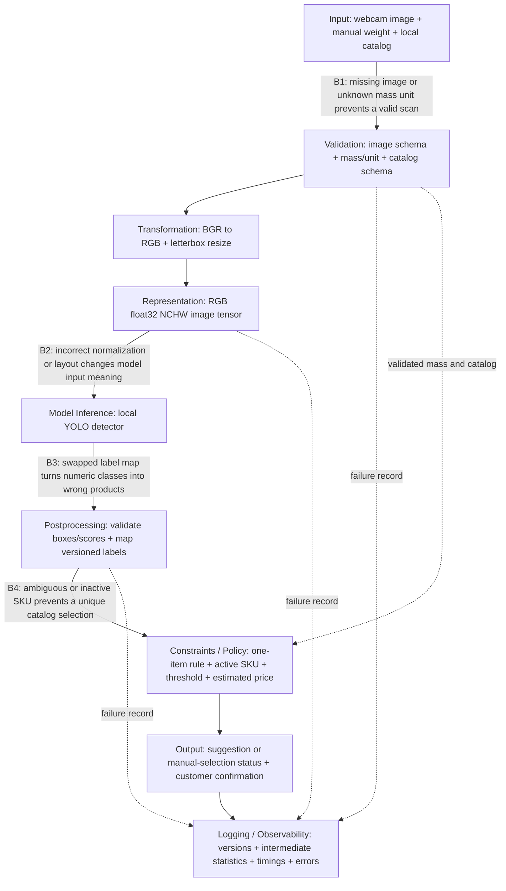

# Produce Recognition for Grocery Self-Checkout

> Implementation update: the live prototype is now built and verified. See [the current Part 2 report](part2_report.md) and [run instructions](../README.md) for the selected YOLO11 baseline, camera/UI checks, and actual failure evidence; the research below records the earlier design.

Ryan Schader | ECE 6/5540 | Revised October 13, 2026

## Project description

This project develops a produce recognition prototype for grocery self-checkout that uses a webcam and a lightweight local AI model to match produce categories to active catalog items. Manually entered weight is used to calculate an estimated price, while validation, customer confirmation, and pipeline logging handle uncertain predictions and support later deployment on an edge device.

## Problem and prototype scope

Customers at grocery self-checkout often need to search manually for loose produce and select its product code. This project explores whether a compact vision model can reduce that effort by suggesting a produce category, matching it to the store's active catalog, and presenting an estimated price for customer confirmation.

The first prototype runs on a Windows computer with an existing webcam. A user places one loose produce item on a plain tray, captures an image, and enters its weight with an explicit unit. The initial demo catalog contains apple, banana, orange, carrot, bell pepper, cucumber, potato, and tomato, with fictional SKUs and sample USD/kg prices. A saved-image input supports reproducible experiments. Edge deployment follows validation of this baseline on a specific device.

Weight is used to calculate price and validate the input. It is not supplied to the vision model or treated as reliable evidence of produce identity: different quantities and varieties can have the same total mass. Price and season are excluded from recognition in this prototype. A learned fusion classifier is deferred until a dataset with paired images, weight readings, and relevant catalog context is available and its benefit can be evaluated.

A produce category is distinct from a product code. An apple prediction cannot establish variety or organic status. The catalog maps each model category to active product entries; multiple matching entries require manual selection. The system also abstains when it finds no supported produce, multiple produce detections, insufficient confidence, or no active catalog match. Confidence thresholds are provisional and do not guarantee rejection of every unfamiliar object.

## Model and data decisions

The first model is the official Open Images pretrained YOLOv8 nano detector, `yolov8n-oiv7.pt`. Its labels include the initial produce categories, allowing the pipeline to be exercised before collecting and training a custom dataset. The default COCO checkpoint has a narrower produce vocabulary. YOLO is used here as a vision detector; a vision-language model is optional future research rather than a required component. See the [official checkpoint documentation](https://docs.ultralytics.com/datasets/detect/open-images-v7/).

If custom training is needed, the main alternatives are a nano YOLO detector for bounding-box annotations, or MobileNetV3-Small/YOLO26n-cls for a controlled image with one item. Candidate comparison will consider recognition on held-out webcam images, abstention behavior, runtime memory, and measured latency. A general model such as SmolVLM-256M-Instruct can be compared later if image/text reasoning becomes useful.

The training route depends on the task: [Fruits-360](https://github.com/fruits-360) and the [Grocery Store Dataset](https://github.com/marcusklasson/GroceryStoreDataset) are candidates for classification; [LVIS Fruits and Vegetables](https://github.com/henningheyen/Fruits-And-Vegetables-Detection-Dataset) provides detection annotations. Class-folder images alone are not a detection-box dataset. Selected classes, duplicate labels, imbalance, and dataset attribution must be reviewed before training.

Webcam captures will cover the actual tray, camera angle, lighting, orientations, and different physical specimens. Training, validation, and test sets will be separated by capture session and physical item where possible, avoiding adjacent-video-frame leakage. Empty scenes, hands, unrelated objects, and unfamiliar produce will be included in rejection evaluation. Public-dataset accuracy alone will not establish performance at the checkout station.

## Updated pipeline architecture

The model receives only the normalized image tensor. Validated mass and catalog data travel separately to policy and pricing. The local catalog is an explicit constraint rather than a feature that silently changes model predictions. Model predictions remain suggestions until customer confirmation; no real payment transaction is implemented.

## Boundary contracts

| Boundary and version | Input -> output shape and type | Units and allowed ranges | Missing-data policy |
| --- | --- | --- | --- |
| Input -> Validation, `scan-v1` | HWC BGR uint8 image, decimal-compatible mass, unit string, catalog object -> validated image, Decimal kg, validated catalog | Three channels; H 32-2160, W 32-3840; pixels 0-255; units kg/g/lb; normalized mass (0,20] kg | Reject missing/undecodable images, missing/nonfinite mass, unknown units, and invalid catalogs; identify boundary in the log |
| Representation -> Inference, `rgb-nchw-01-v1` | Letterboxed RGB uint8[S,S,3] -> contiguous float32[1,3,S,S] | S=320/416/640; finite dimensionless values [0,1]; mass remains outside the tensor | Reject shape, dtype, range, or version mismatch; do not silently apply a second normalization |
| Inference -> Postprocessing, label-map SHA-256 | Float[N,6] rows containing x1,y1,x2,y2,score,class_id -> label/score/box dictionaries | N 0-300; 0<=x1<x2<=S and 0<=y1<y2<=S in model pixels; score [0,1]; integral mapped class IDs | An empty array triggers abstention; missing/invalid rows or a label-map mismatch reject the scan |
| Catalog -> Policy/Output, `catalog-v1` / `checkout-v1` | Validated detections, Decimal kg, catalog -> status, candidates, price strings, confirmation bool | USD/kg prices (0,1000]; 1-100 catalog items; unique SKU strings 1-40 characters; boolean active; provisional score threshold 0.60 | No active match or an ambiguous match requires manual selection; confirmation defaults false |

Pricing uses decimal arithmetic and rounds to cents. The model manifest records preprocessing and label-map versions and the available checkpoint hash. The transform retains padding/scale metadata; boxes currently remain in padded model coordinates. A future overlay must invert that transform before drawing on the camera image.

Type and range checks cannot detect every semantic mistake. Grams falsely labeled kilograms may be numerically plausible, and BGR pixels falsely labeled RGB can retain the expected shape and range. Known-input preprocessing checks and an explicit scale-source contract are therefore needed as those interfaces expand.

## Minimal implementation and failure experiments

The implementation is divided between `prototype.py` (capture, transformation, model adapter, pipeline orchestration, confirmation, and logging) and `pipeline_core.py` (contracts, weight conversion, catalog policy, and price calculation). The webcam captures one snapshot per run. Image and weight are validated before being used by the inference or pricing stages.

Two repeatable failure switches demonstrate protection at different boundaries:

| Injection | What changes | Verified fixture outcome | Preventive boundary and next evidence |
| --- | --- | --- | --- |
| `bad-normalization` | Multiply the normalized image tensor by 255, simulating an omitted /255 conversion | Controlled ContractError at Representation -> Inference, before model invocation | Finite/range/shape/version checks reject ordinary nonzero inputs; collect a baseline and injected real-image run. All-zero input requires additional known-input checks to expose this fault. |
| `wrong-label-map` | Swap two label names while preserving numeric predictions | Controlled ContractError at Inference -> Postprocessing | Bind the class-name mapping to the loaded model artifact and reject a changed mapping; collect an injected actual-model run. This does not independently prove that the original checkpoint labels are semantically correct. |

The CLI catches these errors, identifies the boundary, logs the failure, and exits with a nonzero status. The assignment analysis will record what changed, whether the process crashed, whether the failure was silent, which boundary allowed or caught it, and what architectural change prevents it. A claim about the behavior without a guard will be identified as a counterfactual unless a separate experiment is performed.

## Observability and performance

Each scan emits a structured JSONL record with input shape and channel means, normalized tensor shape/range/channel means, model and label versions, detection counts and scores, stage timings, decisions, and errors. Images are not stored in the normal log. Rolling rates and percentiles require a separate aggregation step.

| Monitor | Purpose and boundary | Initial concerning threshold |
| --- | --- | --- |
| Missing/malformed frames | Camera -> Validation; detect disconnected cameras or decode failures | Any malformed frame; >1% failed scans over 100 scans |
| Invalid mass/unit | Input -> Validation; prevent invalid price calculations | Any unsupported unit, nonfinite value, or value outside (0,20] kg |
| Tensor schema/range/version | Representation -> Inference; detect preprocessing errors | Any contract violation |
| Channel statistics | Transformation -> Representation; reveal exposure/input drift | Mean shift >20% from a measured baseline for 50 scans; add variance and image-quality measures later |
| Invalid boxes/label-map mismatch | Inference -> Postprocessing; prevent incorrect output interpretation | Any invalid row or mapping mismatch |
| Manual-selection rate | Postprocessing -> Policy; detect poor transfer or catalog ambiguity | >30% over 100 scans, or >2x the measured baseline |
| Service latency percentiles | Inputs-ready -> Output; assess the response target | p95 >1000 ms; inspect stage times and warmup separately |
| Catalog/logging errors | Catalog -> Policy and Output -> Observability; protect product selection and evidence | Any duplicate SKU, invalid catalog, or failed log write; add freshness checks with a future catalog updater |

These are proposed starting thresholds, not measured production baselines. The target remains approximately one second after required inputs are ready. Inference is expected to dominate repeated compute, while download, model loading, and initial inference affect cold start. Manual weight entry and confirmation time are measured separately from service latency.

Batch size one suits the interactive scanner. Batching may improve throughput across several checkout lanes but adds queueing, memory demand, and synchronization complexity. The current snapshot implementation has no application frame queue; a future continuous scanner should use bounded buffers, discard stale frames, and synchronize image/weight timestamps. Camera buffering, inference workers, and disk logging are potential sources of backpressure.

## Reflection and development roadmap

The most fragile part of the system is the mapping from a visual category to the customer's intended SKU. The assumption that concerns me most is that recognition transfers to the actual webcam scene and that the single-item restriction is respected. If the model changes, the camera/weight interfaces, catalog logic, confirmation flow, and common logging envelope can remain. Preprocessing, output decoding, label mappings, confidence thresholds, and any future learned fusion features may need immediate revision.

The next milestone is an actual-model saved-image scan and webcam scan, followed by both injected failures and fallback cases. Capture evidence and warmed stage timings, then assemble the required 3-6 page Part 2 document with code, contracts, failure analysis, monitoring, latency discussion, and reflection. Only after this baseline should custom training, image-quality gates, a full manual-selection interface, scale integration, and a specific edge deployment be added.

Current verification consists of 13 passing contract/policy/fixture tests and successful CLI help. Those tests substitute the transform and detector and do not verify OpenCV transformation, webcam access, real YOLO inference, recognition accuracy, or edge speed. The actual-model run remains pending local dependency setup; no measured performance or completed edge deployment is claimed.
