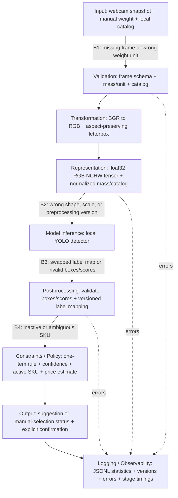

# Proposal review and Part 2 prototype plan

> Implementation update: the live prototype is now built and verified. See [the current Part 2 report](part2_report.md) and [run instructions](../README.md) for the selected YOLO11 baseline, camera/UI checks, and actual failure evidence; the research below records the earlier design.

The recommendations below have been adopted in the [revised project proposal](project_proposal.md), which defines the current project scope. This file retains the supporting research and review rationale.

Reviewed 2026-10-13. Sources: the three-page `ai_arch_proj_desc.pdf` proposal and `project_part2_req.txt`. This is a review and implementation guide, not a completed assignment submission. Hardware choice: Windows computer and existing webcam first, edge deployment later. Weight source: manually entered value with an explicit unit.

## Recommendation and proposal critique

Build a single-item scanner with local model inference, a small versioned catalog, an estimated price, required confirmation, and structured logs. Start with eight broad categories in the supplied fictional catalog. The first milestone is a real image/model scan plus two reproducible contract failures, not maximum recognition accuracy.

The proposal already has a clear checkout use case, local/offline inference, a roughly one-second response target, an active-PLU constraint, and customer confirmation. Preserve those decisions. Its failure table distinguishes model errors from architecture errors, which provides a useful starting point for Part 2.

Revise these details explicitly:

1. **Scope the fusion step.** The proposal says a learned classifier always combines vision embeddings, weight, price, inventory, season, and PLUs. That requires paired training examples covering all those fields. Public produce image datasets generally do not supply checkout weights and store catalogs. For this prototype, the vision model receives the image tensor; weight and catalog go to deterministic policy/price logic. Record this as a scope change, and defer learned fusion. Do not describe the current code as implementing the proposed fusion classifier.
2. **Treat total weight as amount first.** A bag of small apples and a few large apples can have the same mass. Weight alone cannot reliably distinguish species or varieties. It is immediately useful for pricing and later might provide an experimentally validated plausibility feature.
3. **Separate category from PLU/SKU.** An apple prediction does not establish variety, organic status, or a unique store SKU. Use an explicit mapping to active catalog entries; if the mapping has multiple entries, require manual selection. The demo uses fictional SKUs rather than claiming real PLU accuracy.
4. **Keep price out of recognition until justified.** Known catalog prices may provide context, but the purchased item's price depends on selecting the item first. An input price chosen from the true label would leak the answer during training. Season and inventory are fallible context, not proof of identity.
5. **Allow abstention outside the closed set.** An empty tray, hand, packaged item, or unfamiliar produce should lead to retry/manual selection. Confidence thresholds cannot guarantee unknown-object rejection. A single-item classifier especially needs this control because it always returns a class distribution.
6. **Expose every assignment stage.** The original diagram groups validation into preprocessing and omits logging/observability. Split validation, transformation, and representation; annotate actual boundary failures and versions.
7. **Specify the edge target later.** Parameter count alone does not establish deployment compatibility. RAM, supported runtime/operators, camera driver, accelerator, and measured latency all matter. A Windows webcam demonstration establishes the pipeline; it does not prove Raspberry Pi or Jetson performance.

## Webcam feasibility

Yes: a normal webcam is suitable for the first prototype. Ultralytics supports camera sources, and the supplied program captures a frame through OpenCV before calling the model ([prediction documentation](https://docs.ultralytics.com/modes/predict/)). Mount it securely facing a plain tray, keep the whole item visible, use steady diffuse lighting, and move hands away before scanning. Begin with a 640x480 capture and one loose item at a time. The program uses SPACE to scan and accepts kilograms, grams, or pounds as manual weight units.

A webcam supplies visual data; it does not measure mass. Manual entry is a declared replacement for a scale interface. Stable-scale detection and synchronization of image/weight timestamps remain future work. Multiple items, bags, partial occlusion, and changing exposure should be additional experiments after the baseline works.

## Lightweight models researched

YOLO detectors and MobileNet classifiers are vision models; they are not vision-language models. Your vision-plus-weight application does not require a VLM.

| Candidate | Pretraining / produce coverage | Size evidence | Role in this project |
| --- | --- | --- | --- |
| **YOLOv8n Open Images: `yolov8n-oiv7.pt`** | Official pretrained detector covering broad produce labels, including apple, banana, bell pepper, carrot, cucumber, potato, tomato, orange, and others | Official table lists approximately 3.5M parameters | Best first demo: no custom training required; directly returns boxes and category scores |
| **YOLO26n-cls: `yolo26n-cls.pt`** | ImageNet pretrained classifier; fine-tune for your selected produce taxonomy | Official fused model table: 2.8M parameters at 224-pixel input | Good custom-training route for a controlled tray with one item |
| **MobileNetV3-Small** | ImageNet weights; replace/fine-tune the classification head on produce | Torchvision: 2,542,856 parameters and 9.8 MB checkpoint | Strong compact alternative; keeps the spirit of your MobileNet proposal |
| **SmolVLM-256M-Instruct** | General image/text instruction pretraining; model card does not establish produce-specific checkout accuracy | 256M model family; far larger than the compact vision models above | Optional experimental comparison if text/image reasoning becomes necessary |

Sources: [Open Images checkpoints and class list](https://docs.ultralytics.com/datasets/detect/open-images-v7/), [YOLO classification models and training](https://docs.ultralytics.com/tasks/classify/), [Torchvision MobileNetV3-Small](https://docs.pytorch.org/vision/stable/models/generated/torchvision.models.mobilenet_v3_small.html), [SmolVLM model card](https://huggingface.co/HuggingFaceTB/SmolVLM-256M-Instruct).

The normal COCO-pretrained YOLO models cover only a small produce subset: banana, apple, orange, broccoli, and carrot ([COCO class list](https://docs.ultralytics.com/datasets/detect/coco/)). Loading a generic YOLO checkpoint does not provide comprehensive produce recognition. Open Images weights are a better starting point for your requested coverage; download the checkpoint without downloading its large training dataset. Detection scores are not calibrated checkout probabilities, and broad labels do not resolve fine-grained SKU identity.

For custom detection later, YOLO26n is another compact candidate; the official table reports a 2.4M-parameter fused detector. Fine-tune it on bounding-box annotations for your selected produce classes ([model documentation](https://docs.ultralytics.com/models/yolo26/)). Benchmark it against the working baseline rather than replacing the baseline before you have evidence.

I also found community produce checkpoints. One `yolov8n-fruit-detection` repository has no model card, so its taxonomy/training/evaluation are insufficiently documented for a reproducible recommendation ([repository](https://huggingface.co/Danielx927/yolov8n-fruit-detection)). The LVIS produce project supplies trained medium/large/xlarge YOLOv8 weights, which are less suited to your smallest-device goal than training a nano model on its dataset ([project](https://github.com/henningheyen/Fruits-And-Vegetables-Detection-Dataset)). The official Open Images nano checkpoint is the most practical pretrained option found in this review.

After the Windows baseline, consider ONNX Runtime for Windows/CPU inference, TensorRT on NVIDIA Jetson, or a runtime validated for the selected Pi/accelerator. Export support is documented, but operator coverage, quantization support, preprocessing, and detection-output layout need verification for the exact target. Measure accuracy changes after quantization as well as latency ([export documentation](https://docs.ultralytics.com/modes/export/)).

## Produce datasets and training route

| Dataset | Task / annotations | Suitability and limitations |
| --- | --- | --- |
| [Fruits-360](https://github.com/fruits-360) | Class-folder images; repositories include resized/original images, attributes, and multi-object variants | Straightforward classifier transfer learning. Controlled acquisition/backgrounds can differ substantially from a webcam checkout scene. Standard class-folder images are not sufficient YOLO detection annotations. |
| [Grocery Store Dataset](https://github.com/marcusklasson/GroceryStoreDataset) | 5,125 natural store images, 81 fine classes grouped into 42 coarse classes; supplied splits and labels | More realistic visual context; select relevant fruit/vegetable classes and use coarse labels initially. Primarily classification labels, not a ready detection-box dataset. |
| [LVIS Fruits and Vegetables](https://github.com/henningheyen/Fruits-And-Vegetables-Detection-Dataset) | 8,221 images, 63 classes, converted YOLO detection labels | Direct route to fine-tuning a nano detector. Author notes class imbalance and problematic duplicate labels; inspect/clean the selected classes and preserve consistent IDs. |
| Your webcam captures | Class folders for classification; manually drawn boxes for detection | Best way to cover your tray, lighting, camera height, and actual produce. Hold out separate acquisition sessions and physical items. |

For a first fine-tuning experiment, choose five to eight clearly different categories and gather approximately 50-100 varied captures per category as a starting budget, including different physical specimens, orientations, and lighting. This is a planning estimate, not an accuracy guarantee. Add empty tray, hands, and unrelated-object examples to evaluate rejection; detection negatives can use empty label files. Do not split neighboring frames of the same video randomly across training and test. Near-duplicate leakage can make test accuracy misleading. Evaluate on held-out webcam sessions even when training starts with public datasets.

For a one-item classifier, arrange `data/produce/train/<class>`, `val/<class>`, and `test/<class>`. A starting command is:

```powershell
yolo classify train model=yolo26n-cls.pt data=data/produce epochs=30 imgsz=224 batch=8 device=cpu
```

For a detector, use a YAML with train/val paths and your ordered names plus per-image box labels; initialize from pretrained weights:

```powershell
yolo detect train model=yolo26n.pt data=data/produce.yaml epochs=30 imgsz=640 batch=8 device=cpu
```

These are starting configurations, not executed training runs. Training can happen on a more capable computer while inference remains local. Record dataset revision, class mapping, preprocessing, dependency versions, and checkpoint hash. Add attribution/license information for the dataset you actually use; Fruits-360 specifies CC BY-SA 4.0 in its source repository.

## Part 2 coverage and architecture

The assignment requests a **3-6 page PDF or Markdown document plus code**, with seven components. Model performance is explicitly not the grading criterion. The relative due date says two weeks from the assignment's 'today'; no posting date is provided, so confirm the actual deadline in Canvas rather than deriving it from this review date.

| Required component | Current prototype / work still needed |
| --- | --- |
| Updated diagram with all nine stages and at least three failure annotations | Proposed diagram below; include it in the submission |
| At least three explicit boundary contracts | Four contracts below, implemented in code |
| Minimal real-model pipeline with intermediate logs | Implemented in `prototype.py`; actual webcam/model run still needs local setup and verification |
| At least two intentional failures and analysis | Two CLI switches and passing fixture checks; run both on a real baseline image and retain logs |
| At least five monitors, reasons, boundaries, thresholds | Proposed monitoring table below; runtime emits raw observations, not an alerting system |
| Latency/throughput analysis | Conceptual analysis below; collect measured stage timings locally |
| Reflection, at most one page, answering four questions | Suggested topics below; write the final reflection using your real observations |



Weight/catalog are structured policy inputs carried beside the image tensor; they are not silently inserted into an image-only neural network. Transformation preserves geometry metadata; model boxes in this prototype remain in padded model-pixel coordinates. An image overlay would need to remove padding and invert the actual x/y scale.

### Explicit contracts

| Boundary / version | Input shape and type | Output shape and type | Units / allowed ranges | Missing-data policy |
| --- | --- | --- | --- | --- |
| Input -> Validation, `scan-v1` | HWC BGR `uint8` array; decimal-compatible mass; unit string; catalog object | Validated image + `Decimal` kilograms + validated catalog | H 32-2160, W 32-3840, C=3, pixels 0-255; unit kg/g/lb; normalized mass (0,20] kg | Reject missing/undecodable frames, missing/nonfinite mass, unsupported unit, invalid catalog; log boundary |
| Representation -> Inference, `rgb-nchw-01-v1` | RGB letterboxed `uint8[S,S,3]` | Contiguous `float32[1,3,S,S]` | S=320/416/640; finite dimensionless pixels [0,1]; mass stays outside tensor | Reject incorrect shape/dtype/range/version; never silently normalize twice |
| Inference -> Postprocessing, label-map SHA-256 | `float[N,6]` rows x1,y1,x2,y2,score,class_id + names | List of label/score/box dictionaries | N 0-300; boxes satisfy 0<=x1<x2<=S and 0<=y1<y2<=S in model pixels; scores [0,1]; integral mapped IDs | Empty detections are valid and trigger abstention; missing/invalid output or label-hash mismatch is an error |
| Postprocessing -> Policy/Output, `catalog-v1` / `checkout-v1` | Detection dictionaries + Decimal kg + catalog items | Status string, confirmation bool, and candidate list with decimal price strings | USD/kg price (0,1000]; catalog 1-100 items; unique SKU strings 1-40 chars; names 1-80 chars; boolean active; threshold 0.60 initially | No supported item, low score, inactive match, multiple detections, or ambiguous SKU -> manual selection; confirmation defaults false |

These are prototype limits, not universal produce limits. Integer-like class IDs may arrive in floating tensors and are checked before conversion. Currency calculation uses decimal arithmetic and rounds to cents. Semantic errors such as BGR data falsely declared RGB or grams falsely declared kilograms can pass shape/range checks; a version string alone cannot verify the origin of data.

### Failure injection and analysis

| Experiment | What changes | Crash / silent outcome | Boundary and prevention |
| --- | --- | --- | --- |
| `--inject bad-normalization` | Scale the correctly normalized tensor back to 0-255, simulating omitted /255 | Fixture run raises a controlled ContractError before inference; CLI catches errors, logs them, and exits 2. Not a silent acceptance. Actual-model run remains to be collected. | Representation -> Inference; dtype/shape/range checks plus a known-color preprocessing test prevent many scale errors. All-zero input cannot reveal this particular fault using range alone. |
| `--inject wrong-label-map` | Swap two names after inference without changing numeric predictions | Fixture run raises a controlled ContractError before catalog mapping; CLI handles it as an error. Actual-model run remains to be collected. | Inference -> Postprocessing; bind labels to the model artifact via a manifest/hash and reject disagreement. Runtime checking catches divergence from loaded labels, not a checkpoint shipped with a semantically wrong map. |

For each real experiment, save the normal run and injected run, identify the actual boundary in JSONL, and answer all five assignment questions: what changed; whether it crashed; whether it silently failed; which boundary allowed it; and which architecture change prevents it. To illustrate an unguarded silent failure, explain the counterfactual or run a separately identified unsafe experiment; do not claim a guard-bypass experiment has already been executed.

### Observability plan

Thresholds below are proposed starting alerts to tune using normal scans. They are not measured distributions or deployed alerts.

| Monitor | Why / boundary protected | Initial concerning threshold |
| --- | --- | --- |
| Missing or malformed frames | Camera -> Validation; disconnected camera/decoder failure | Any malformed frame; >1% scan failures across 100 scans |
| Weight validity and source units | Input -> Validation; unit mistakes corrupt pricing | Any missing/nonfinite/out-of-range mass; unsupported unit; add explicit scale-source metadata later |
| Tensor shape, range, and version | Representation -> Inference; bad normalization/layout | Any nonfinite value, value outside [0,1], shape/version mismatch |
| Per-channel means and variance | Transformation -> Representation; exposure or preprocessing drift | Mean shift >20% from baseline for 50 scans; add variance/blur measurements to emitted stats when image-quality gates are implemented |
| Label-map mismatch / bad boxes | Inference -> Postprocessing; output misinterpretation | Any mismatch/invalid row; block that scan |
| Manual-selection / ambiguity rate | Postprocessing -> Policy; domain shift or catalog mismatch | >30% across 100 scans, or >2x measured baseline |
| Service latency p50/p90/p99 | Input-ready -> Output; expensive inference or load | p95 >1000 ms against the proposal target; investigate stage breakdown and first-run warmup separately |
| Catalog freshness / SKU failures | Catalog -> Policy; stale product/price data | Any duplicate SKU/inactive selection; propose max catalog age 24 h for a future updater (freshness is not implemented) |
| Logging failures | Output -> Observability; lost audit evidence | Any failed JSONL write; current CLI reports it and exits nonzero |

The code emits statistics, timings, decisions, versions, and errors to `logs/scans.jsonl`, without storing camera images. A separate aggregator would calculate rolling rates/percentiles. Detector scores are independent detection scores, not a normalized class-probability vector, so classification entropy should not be computed from them as if they were one.

### Latency, throughput, and reflection topics

Model inference is likely the most expensive repeated compute stage; verify this from logs. Initial model download/load and first inference can dominate cold start and must be measured separately. The approximately one-second target is a latency requirement after inputs are ready; manually typing weight and confirmation are human interaction times, not neural inference latency. No real latency has been measured in this session.

The prototype is synchronous and captures one snapshot per process run, so it has no application frame queue. In a future live loop, backpressure can accumulate at inference, camera buffering, disk writes, or a shared worker serving multiple lanes. Use a bounded latest-frame buffer, discard stale frames, and record frame/weight timestamps. Batching can improve multi-lane throughput but adds waiting, memory, and synchronization complexity; batch size one suits the current interactive scanner.

For the required reflection (one page maximum), address: (1) the fragile boundary between visual category and SKU; (2) the assumption that public-data recognition transfers to your webcam and that only one item is present; (3) the camera/weight input, catalog policy, confirmation, and common log envelope that could remain when a model is replaced; and (4) the preprocessing, output adapter, label mapping, thresholds, and learned embeddings/fusion head that could immediately break. Use the observations from your own demo rather than treating these suggestions as experimental findings.

## Practical sequence and verification status

1. Follow the Windows setup in `README.md`; run a normal saved-image scan and webcam scan with manual weight. Check estimated-price math and confirmation behavior.
2. Record empty-scene, low-confidence, inactive-catalog, and two-item fallbacks. These reveal limits that positive fruit examples alone miss.
3. Run both injected failures on the same baseline image and save JSONL evidence. Add your observations to the analysis table.
4. Measure multiple warmed scans and report stage latency plus failures; retain dependency versions and checkpoint hash. Keep model accuracy as optional supporting evidence.
5. Condense the architecture, contracts, failure evidence, monitoring, conceptual latency analysis, and your reflection into the required 3-6 pages. Submit that document with the code.
6. Fine-tune a selected compact model only after the working pipeline and evidence are secure; export and benchmark on a specific edge target later.

**Completed here:** prototype source, fictional catalog, setup instructions, research, and 13 passing contract/policy/fixture tests; CLI help verified. **Not verified here:** OpenCV transformation, physical webcam access, actual YOLO inference, training, or edge speed. The session lacks the vision dependencies and its network restrictions blocked package installation. The tests explicitly use a fake detector and a transform fixture; they establish contract/policy behavior, not model performance. PDF text was read in full using decoded content streams because the installed MiKTeX PDF tool requires setup; proposal layout was not visually verified.
